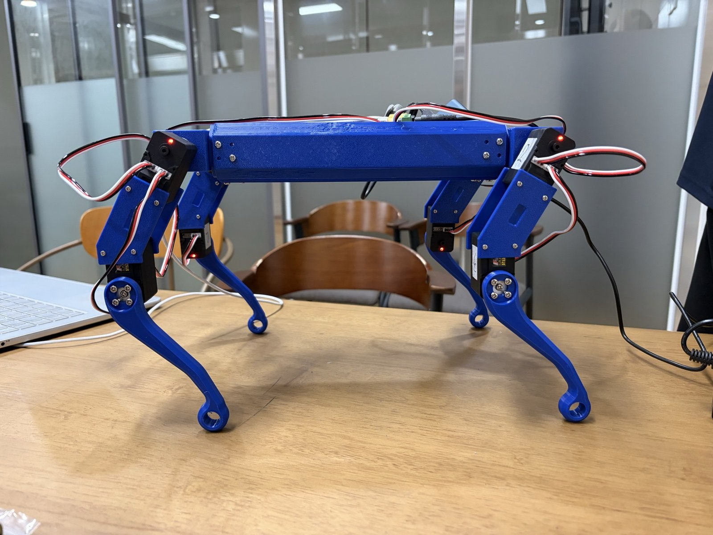
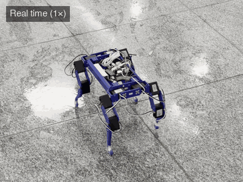
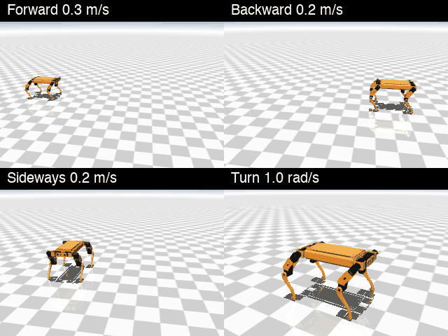

# OpenRoboticDog RL

A reinforcement-learned, joystick-controlled walking policy for the OpenRoboticDog quadruped, built by HR Robotics, the robotics club at Haeryong High School (해룡고등학교).

The policy is trained in simulation (MuJoCo Playground + Brax PPO) and runs on the real robot from a Raspberry Pi, driven from a phone web joystick.
It is based on the robot design of [garciamathias/OpenRoboticDog](https://github.com/garciamathias/OpenRoboticDog). Everything this fork adds is in [`rl/`](rl/).

<p align="center">
  
  
  
</p>

Left to right: the robot (3D-printed body, 12 STS3215 servos, Raspberry Pi 5, BNO055 IMU, 1.5 kg), walking on the real robot (learned policy, real time, joystick control), and the policy in the sim (forward, backward, sideways and turning, 5 s each).

## Policy status

The policy is under active development and will keep being upgraded.

| Version | Trained on | Notes |
|---|---|---|
| `g4s_6_hybrid_filter_282M` (current) | Google Colab, single G4 GPU, 281.8 M steps in 2 h 16 min | First release. Forward/backward and turning work well, sideways is weaker |

## Quick start

```bash
cd rl
python3 -m venv .venv && .venv/bin/pip install -r sim/requirements.txt
.venv/bin/mjpython deploy/run_policy.py --policy deploy/policies/g4s_6_hybrid_filter_282M.npz --sim --sim-servo hybrid
```

Open `http://127.0.0.1:8080`, press START, then hold and drag the pads.

## Documentation

- [`rl/README.md`](rl/README.md): setup, running in the sim and on the robot, calibration, training
- [`rl/deploy/policies/README.md`](rl/deploy/policies/README.md): policy versions, settings and command tracking
- [`rl/docs/HARDWARE.md`](rl/docs/HARDWARE.md): hardware, wiring and power
- [`rl/sim/sysid/SERVO_DATASHEET.md`](rl/sim/sysid/SERVO_DATASHEET.md): measured servo data

## Credits

The robot design, 3D files, Fusion360 files and the original `max_v1` code are by [Mathias Garcia](https://github.com/garciamathias) in [garciamathias/OpenRoboticDog](https://github.com/garciamathias/OpenRoboticDog), released under the MIT License. See [`ORIGINAL_README.md`](ORIGINAL_README.md).
